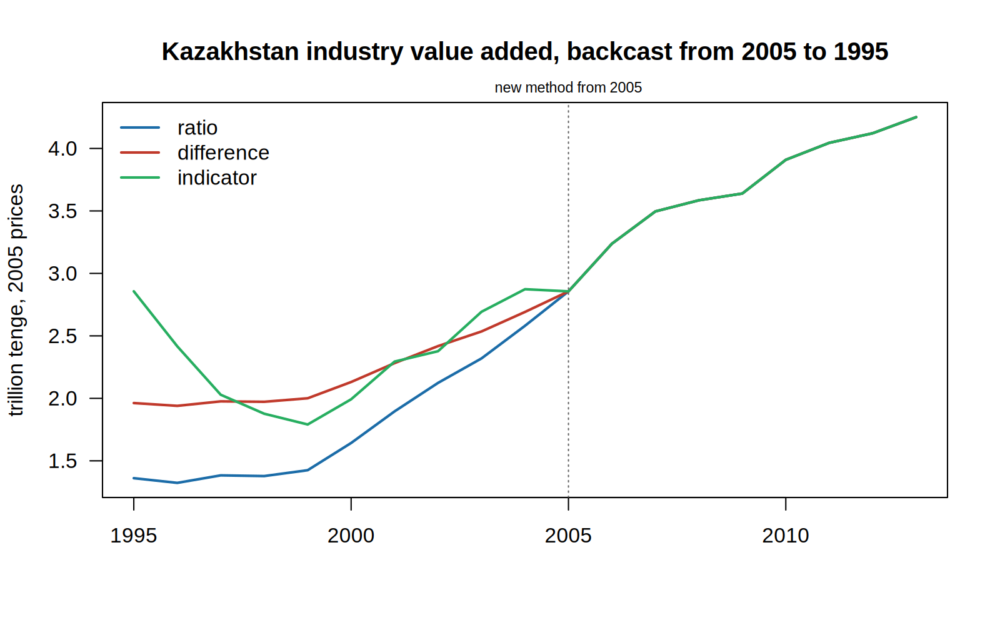

# Series break backcaster

When a statistics office changes how it measures something (a new base year, a new industry
classification, a redesigned survey), the series jumps for a reason that has nothing to do with
the economy. The office publishes the new method from some year on, and users either glue the
old and new parts together or cut the history off. How the gluing is done matters. Prados de la
Escosura shows that the usual splice, which carries the level gap back unchanged
(retropolation), tends to overstate past levels and understate growth, and proposes
interpolation instead
([CAGE WP 202, 2014](https://warwick.ac.uk/fac/soc/economics/research/centres/cage/manage/publications/202-2014_leandro_prados_de_la_escosura.pdf);
*Cliometrica* 2016). Bill Martin argues that the ONS's 2014 splice of post-war UK investment was
a mistake that is still in the official historic accounts
([Cambridge CBR WP543, 2025](https://www.jbs.cam.ac.uk/wp-content/uploads/2025/07/cbr-wp543.pdf)).
The UN handbook on backcasting national accounts, which describes retropolation, interpolation
and mixed splicing, is still a September 2018 draft
([UNSD](https://unstats.un.org/unsd/nationalaccount/aeg/2018/M12_8iiib_Backcasting.pdf)). The
Australian Bureau of Statistics added a backcasting facility to its own seasonal adjustment
software in 2006
([ABS Methodological News](https://abs.gov.au/ausstats/abs@.nsf/7d12b0f6763c78caca257061001cc588/371b091c80e5aa77ca25729d000f70f0!OpenDocument)).
On CRAN, packages exist for
benchmarking and temporal disaggregation (`tempdisagg`, `gseries`, `rjd3bench`) and for
chain-linking index numbers (`IndexNumberTools`), but none backcasts a series across a
methodology break or compares the ways of doing it.

This tool extends the new-method series back with several published methods side by side,
reports how far they disagree, and measures each method's error where the office published both
series for a few years.

It is the official-statistics twin of
[breakpoint-drift](https://github.com/FerrumSL/breakpoint-drift), which separates a change in
antibiotic breakpoints from a real change in resistance: in both, a change in how something is
measured has to be told apart from a change in the thing itself.

**Status:** v1. Four methods, synthetic tests, a validation on four real Kazakhstan revisions,
and a backcast of Kazakhstan's industry value added to 1995.

## Methods

`old` and `new` are named numeric vectors (names are years) that share at least one year, the
link. Each method returns the new series extended back to the first old year.

| Function | Assumes | Keeps from the old series |
|---|---|---|
| `splice_ratio()` | the gap is a constant factor | growth rates |
| `splice_difference()` | the gap is a constant amount | absolute changes |
| `splice_interpolate(base = )` | the old series was right in its own base year and the gap built up gradually since, as its weights went out of date (Prados de la Escosura) | growth rates, corrected by a geometric drift |
| `splice_indicator(indicator = )` | a related series was measured the same way throughout | nothing; predicts from the indicator |

`backcast_compare()` runs every method that applies and adds `spread_pct`, the range across
methods as a share of their mean, per year. `backcast_growth()` gives each method's average
yearly growth over a span. `backcast_validate()` hides the first years of the new series where
both were published, backcasts them, and reports the error against the published values.

```r
source("R/backcast.R")
x <- backcast_compare(old, new, base = 2005)
backcast_growth(x, from = 2000, to = 2015)
backcast_validate(old, new, hide = 2015, method = splice_ratio)
```

## Tests

`tests/testthat/test_backcast.R` builds a true series growing 3% a year, distorts it in a known
way to make the old one, and checks which methods recover it:

- a constant level factor: the ratio splice is exact, the difference splice is not
- a constant amount: the difference splice is exact, the ratio splice is not
- a gap that builds up from the old base year (2005) to 20% at the link (2015): interpolation
  is exact, while the ratio splice gives 1.8% a year of growth for 2000-2015 instead of 3%
- an exact or slightly noisy indicator: the indicator method recovers the level
- with no distortion all methods agree and the spread is zero
- validation on a published overlap gives zero error for the right method

```sh
Rscript -e 'testthat::test_dir("tests/testthat")'
```

## Kazakhstan: four real revisions

The World Bank keeps every past release of its World Development Indicators (WDI Database
Archives, API source 57). Where a later release revised a series' history, the earlier release
is the old-method series and the later one the new-method series, published for the same years.
Kazakhstan's national accounts in WDI come from the Bureau of National Statistics as chained
volumes rescaled to a reference year (2005 today, per WDI's country notes). The reference year
in each release can be read off the data: it is the year where constant and current prices
match. It was 1995 in the October 2009 release, 2000 from December 2010 and 2005 from
December 2014.

`scripts/kazakhstan.R` takes four revisions, hides the first years of the new series,
backcasts them from the old one, and compares with what was published. A new release carries
its own method back only to its reference year (before it, the new series is the old one
rescaled by a constant), so only years from that reference year on are hidden.

| Case | Change | Hidden | Ratio | Difference | Interpolation | Indicator |
|---|---|---|---|---|---|---|
| Industry value added, Dec 2014 release | reference year 2000 to 2005, growth rates revised | 2005-2008 | **1.29** | 5.41 | n/a | 4.12 |
| Industry value added, Dec 2025 release | history revised, mostly from 2009 on | 2005-2014 | 0.45 | 0.46 | **0.41** | |
| GDP, Dec 2014 release (control) | reference year 2000 to 2005, growth rates unchanged | 2005-2008 | **0.00** | 5.01 | n/a | 1.63 |
| Population, Dec 2024 release | every year back to 1995 revised | 2009-2015 | **0.11** | 0.28 | 1.69 | |

Mean absolute error of the backcast, % of the published level; best method in bold. The
indicator is electricity production (kWh, from IEA energy balances), fitted on the new-method
years after the hidden ones. Full results, including the average growth each method implies over
the hidden years, are in `results/kazakhstan.csv`; the cases are described in
`results/kazakhstan_cases.csv`.

- The control works: the GDP release changed only the reference year, so the ratio splice is
  exact.
- The difference splice is the wrong tool for growing series. Over 2005-2009 it gives industry
  growth of 3.3% a year against 6.2% published, and GDP 3.1% against 6.0%.
- On the industry change, even the best method misses: the ratio splice gives 5.9% a year
  against 6.2%, because the new release revised the industry's own growth rates.
- Interpolation does not apply to a change of reference year: the two releases are in prices of
  different years, so the ratio new/old is never 1, which interpolation assumes for the old base
  year. Where both releases are in the same units, it was best on the 2025 industry revision
  and worst on population, where every year was revised rather than a gap building up after the
  2009 census.

## Kazakhstan: industry value added back to 1995

The December 2014 release measures industry on the 2005 reference year. Taking it as published
from 2005 and backcasting 1995-2004 from the old release gives:



| Method | Average growth 1995-2013 |
|---|---|
| ratio | 6.5% a year |
| difference | 4.4% a year |
| indicator (electricity production) | 2.2% a year |
| as published by the World Bank | 6.5% a year |

The methods disagree by 4.3 percentage points a year on long-run industry growth, and by 73%
on the 1995 level (`spread_pct` in `results/industry_backcast.csv`). The World Bank's published
back years are the ratio splice to within rounding. The validation above favours the ratio
splice for this kind of change. Electricity is a poor indicator here: power output fell by 29% from
1995 to 1999 while industry held level, so it puts the early years too high.

Run `Rscript scripts/kazakhstan.R`. It downloads the releases it needs once into
`data/raw/wdi_kaz_vintages.csv` and reruns offline after that.

## Next

- Cases straight from the Bureau of National Statistics: the population series recalculated
  after the 2021 census, OKED classification changes, labour force survey redesigns.
- A better indicator for industry (oil and metals output).
- Break detection as a check on the documented break date (`strucchange::breakpoints`).

R 4.6.1; packages pinned in `renv.lock` (`renv::restore()`). Licence: GPL-2.
